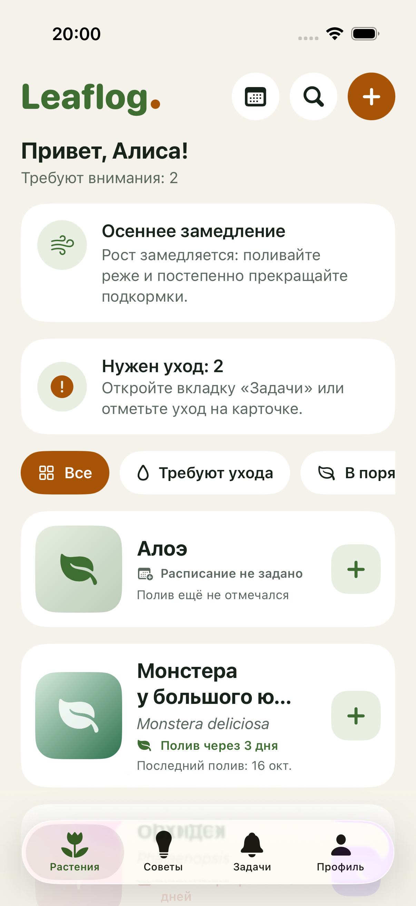
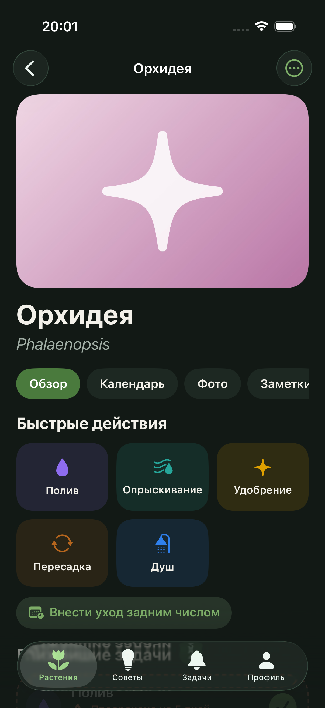
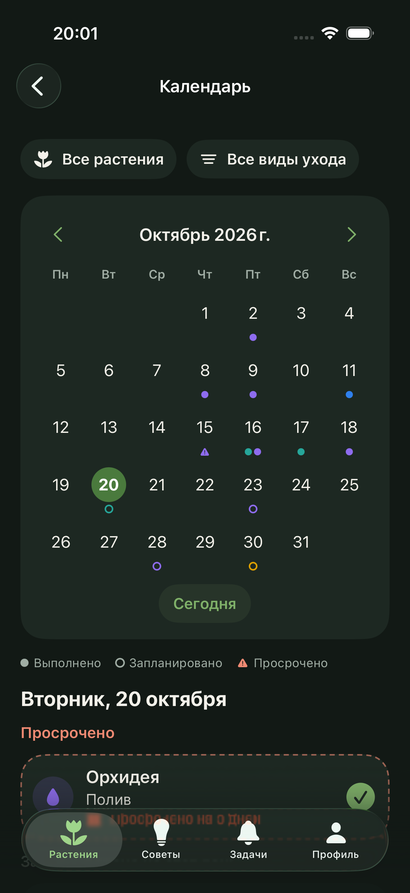
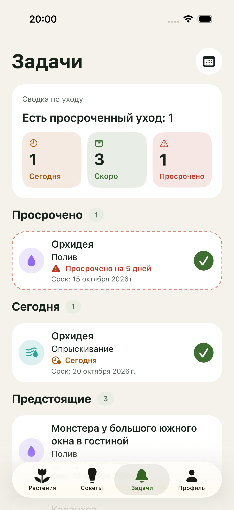

# Leaflog («Листик»)

Локальный дневник домашних растений для iPhone: карточки растений, фотодневник, заметки, календарь ухода,
гибкие расписания и локальные напоминания. **Всё работает без интернета и без аккаунтов** — данные остаются на устройстве.

<p>




</p>

> Все скриншоты в репозитории сделаны на синтетических демо-данных (`-LEAFLOG_DEMO`).

## Возможности
Коллекция растений (поиск, архив), карточка растения (быстрые действия, задачи, история, фотодневник, заметки, советы),
пять встроенных видов ухода и свои (цвет + иконка), расписание «каждые N дней/недель/месяцев» для каждого растения отдельно,
календарь растения и общий календарь с фильтрами, локальные уведомления с повтором просрочки, справочные советы без AI,
экспорт и импорт резервной копии через «Файлы», Light/Dark, Dynamic Type, VoiceOver, русский интерфейс.

## Требования и запуск
- Xcode 27.1 (проверено), iOS 17.0+ (SwiftData), Swift/SwiftUI, внешних зависимостей нет.
- Откройте `Leaflog.xcodeproj`, выберите схему **Leaflog**, симулятор или подключённый iPhone, нажмите Run.
- **Свой аккаунт Apple (другой Mac или другой разработчик).** Идентификатор по умолчанию принадлежит владельцу репозитория, и под другой командой Xcode выдаст «Failed Registering Bundle Identifier». Решение без правки проекта:
  ```bash
  cp Config/Local.xcconfig.example Config/Local.xcconfig
  ```
  и впишите в `Config/Local.xcconfig` свой уникальный `LEAFLOG_BUNDLE_ID` (например, `com.ваше-имя.leaflog`) и `LEAFLOG_TEAM` (Team ID из Xcode → Settings → Accounts). Файл в git не попадает. Данные приложения с другим идентификатором хранятся отдельно; перенос — через резервную копию (см. BACKUP.md).
- Тесты: `⌘U` или
  ```bash
  xcodebuild -project Leaflog.xcodeproj -scheme Leaflog -destination 'platform=iOS Simulator,name=iPhone 17 Pro' test CODE_SIGNING_ALLOWED=NO
  ```
- Демо-режим (изолированное хранилище, ваша коллекция не затрагивается): аргумент запуска `-LEAFLOG_DEMO`;
  пустое изолированное хранилище — `-LEAFLOG_EMPTY`.

## Документация
| Документ | О чём |
|---|---|
| [REQUIREMENTS.md](REQUIREMENTS.md) | требования, экраны, принятые допущения |
| [DESIGN_SYSTEM.md](DESIGN_SYSTEM.md) | цвета, компоненты, темы, что взято из референсов |
| [ARCHITECTURE.md](ARCHITECTURE.md) | модели, хранение, файлы, слои |
| [CARE_SCHEDULING.md](CARE_SCHEDULING.md) | формулы и примеры пересчёта сроков |
| [NOTIFICATIONS.md](NOTIFICATIONS.md) | стратегия уведомлений и ограничения iOS |
| [BACKUP.md](BACKUP.md) | экспорт/импорт, формат файла, удаление приложения |
| [QA.md](QA.md) | сценарии проверки и результаты |
| [STATUS.md](STATUS.md) | что сделано, что осталось, блокеры |

## Приватность
Нет backend, аналитики, рекламных SDK, платных API и удалённой загрузки фото. Фото копируются в приватную папку приложения.
Репозиторий содержит только исходный код; `.gitignore` исключает данные, базы, резервные копии, ключи и профили подписи.
